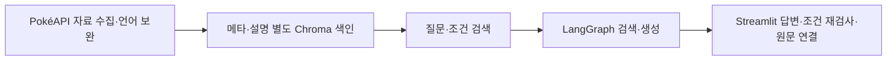

# 포켓몬 리서치 랩

> 포켓몬을 찾고, 질문하고, 원문 출처로 확인하는 백과형 RAG 웹 앱

[주요 기능](#주요-기능) · [서비스 흐름](#서비스-흐름) · [실행 방법](#실행-방법) · [상세 문서](#상세-문서)

## 프로젝트 개요

- **문제**: 도감·특성·진화 정보를 자연어로 탐색하고 답변의 근거까지 확인하는 사용 흐름
- **대상**: 전국도감 1~1,025번의 한국어·영문 이름, 속성 및 설명 자료
- **접근**: 구조화 메타 조건 검색과 설명 문서 검색 분리, 인용·원문 링크 연결
- **현재 상태**: 로컬 실행형 학습 프로젝트; 인터넷 서비스 배포 미완료

## 주요 기능

| 기능 | 구현 범위 |
| --- | --- |
| 백과 탐색 | 1,025종 목록·이름/번호 검색·타입/신체/종족값 확인 |
| 근거 기반 대화 | 도감·특성·진화 질문, 답변 인용과 실제 사용 원문 링크 |
| 자연어 조건 탐색 | 세대·타입·키·몸무게·능력치 조건 해석 및 속성 재검사 |
| 언어·버전 구분 | 게임 버전 지정, 원본 한국어와 생성 번역 표시 |

- 예시: `1세대 전기 타입 중 몸무게 10kg 이하`, `피카츄의 진화 조건을 찾아줘`
- 화면·기능별 결과: [캡처 모음](result/README.md)

## 서비스 흐름

## 데이터와 기술

- **원천**: PokéAPI 고정 자료; [데이터 출처와 이용 범위](docs/rag/pokemon/DATA.md)
- **구성**: 메타 1,025종, 원본 설명 64,017문서, 한국어 보완본 64,264문서
- **기술**: Python, Streamlit, Chroma, LangGraph, SSAFY GMS Responses·임베딩
- **모델·청킹 설정**: [RAG 설계](docs/rag/pokemon/RAG_DESIGN.md), `config/pokemon_rag.toml`
- **구조**: `src/pokemon/` 서비스 로직 · `streamlit_lab/` 화면 · `scripts/` 수집·색인 · `tests/` 검사 · `docs/` 설계·검증

## 실행 방법

- Python 환경 구성 → `requirements-pokemon-rag.txt` 설치 → 로컬 `GMS_KEY` 설정
- 수집·번역·색인·이미지 준비 후 Streamlit 실행; 단계별 명령은 [실행 가이드](docs/SETUP.md)
- 접속: 실행 중인 PC의 `http://127.0.0.1:8501`
- 번역·임베딩·답변 생성: GMS 호출 가능; 준비된 자료 재생성 불필요
- 데이터·다운로드 이미지·벡터 DB·키: Git 제외, 원본 데이터 배포 없음

## 검증과 한계

- 기존 기능 검사 기록: 63개 테스트; 공개본 검사는 로컬 데이터 부재로 7개 건너뛰고 56개 통과한 별도 기록 존재
- 이번 README 정리: 문서 링크·경로 확인; 전체 서비스 테스트와 1,025종 답변 품질 평가 재실행 없음
- 생성 번역 247개: 공식 한국어 문구 또는 사람의 전수 검수 결과와 구분
- 인용 번호 검증: 답변 사실 정확성의 자동 보장과 구분
- 모든 게임·폼·진화 예외·기술표 포괄 불가; 대화 기록은 브라우저 세션 범위
- 세부 검증·실측 범위: [검증 문서](docs/VALIDATION.md), [후속 검토](docs/rag/pokemon/FINAL_REVIEW.md)

## 상세 문서

| 문서 | 내용 |
| --- | --- |
| [실행 가이드](docs/SETUP.md) | 환경·키·자료 준비·실행 명령 |
| [설계](docs/rag/pokemon/RAG_DESIGN.md) | 검색·생성·설정 |
| [검증과 공개 범위](docs/VALIDATION.md) | 실측·한계·출처·권리 |
| [데이터](docs/rag/pokemon/DATA.md) | 원천·포함/제외·이용 범위 |
| [개발 이력](docs/history/DEVELOPMENT_HISTORY.md) | 이전 README·작업 시각·디자인 이력 |

- 비공식 학습 프로젝트; 코드 공개와 포켓몬 문구·캐릭터·이미지·상표의 권리는 별개
