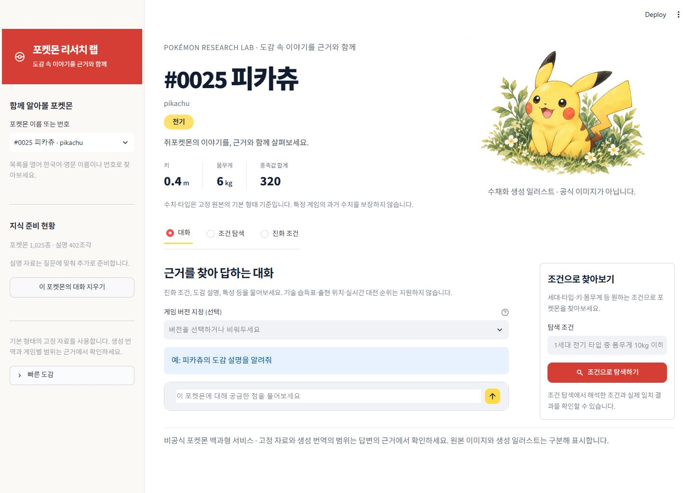
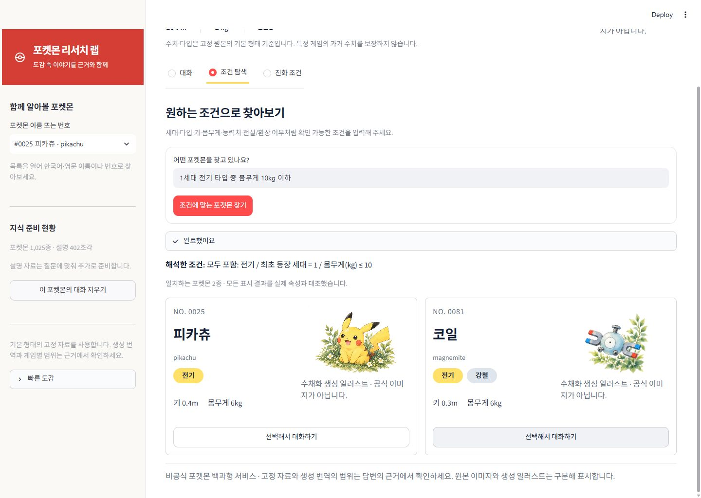

# 포켓몬 리서치 랩

**포켓몬을 찾고, 질문하고, 출처로 확인하는 포켓몬 백과형 RAG 웹 앱입니다.**

전국도감 1~1,025번을 대상으로 도감 설명·특성·진화 조건을 탐색합니다. 자연어 조건으로 포켓몬을 찾고, 선택한 포켓몬에 대해 근거를 확인하며 대화할 수 있습니다.

[실행 후 서비스 열기](http://127.0.0.1:8501) · [데이터와 출처](docs/rag/pokemon/DATA.md) · [RAG 설계](docs/rag/pokemon/RAG_DESIGN.md) · [검증 및 한계](docs/rag/pokemon/SUBMISSION.md)

> 위 주소는 앱을 실행한 컴퓨터에서 접속하는 로컬 주소입니다. 공개 GitHub 저장소와 별개로, 인터넷에서 접속할 수 있는 서비스 배포는 아직 하지 않았습니다.

## 화면





전자 도감 스타일에 수채화 일러스트를 결합했습니다. 피카츄·코일은 생성 일러스트, 다른 종은 PokéAPI에서 확보한 원본 이미지를 사용하며 화면에 구분과 출처를 표시합니다. 이미지가 없으면 회색 공통 실루엣과 물음표를 표시합니다.

## 주요 기능

| 기능 | 제공 내용 |
|---|---|
| 포켓몬 백과 | 한국어·영문 이름과 도감 번호로 1,025종 선택, 타입·키·몸무게·종족값 확인 |
| 근거 기반 대화 | 도감·특성·진화 질문, 답변 인용 번호와 실제 사용한 원문 링크, 포켓몬별 세션 대화 |
| 자연어 조건 탐색 | 세대·타입·키·몸무게·능력치·전설/환상 여부 조건 해석, 실제 속성 재검사, 결과 선택 후 대화 이동 |
| 진화 조건 | 검색된 조건 행을 출처와 함께 표시하고 조건의 AND/OR·형태·게임 범위를 안내 |
| 버전과 번역 표시 | 게임 버전 지정, 원본 한국어와 생성 한국어 구분, 영어 원문 연결 |
| 상태 안내 | 자료 준비·검색·생성 진행, 키·색인 누락·빈 결과·실패 안내 |

예시 질문:

- `피카츄가 라이츄로 진화하는 조건을 찾아줘`
- `미라이돈의 바이올렛 도감 설명을 한국어로 찾아줘`
- `1세대 전기 타입 중 몸무게 10kg 이하`
- `키 50cm 이하이고 몸무게 1000g 이하인 포켓몬`

## 빠른 시작

Python 3.11 이상과 SSAFY GMS 사용 권한이 필요합니다. Windows PowerShell 기준이며 프로젝트 루트에서 실행합니다.

```powershell
git clone https://github.com/cheese-flavor/pokemon-research-lab.git
cd pokemon-research-lab
python -m venv .venv
.venv/Scripts/python.exe -m pip install -r requirements-pokemon-rag.txt
```

빈 `.env.example`을 참고해 **로컬 `streamlit_lab/.env`** 파일을 만들고 `GMS_KEY`를 직접 설정합니다. 기존 키 파일이 있다면 덮어쓰지 않습니다. 키를 Git에 올리지 않습니다.

```dotenv
GMS_KEY=
```

데이터는 공개 저장소에 포함하지 않으며 아래 순서로 준비합니다. 번역·임베딩·답변 생성은 GMS 호출이 발생할 수 있습니다.

```powershell
.venv/Scripts/python.exe scripts/collect_pokemon_bulk.py
.venv/Scripts/python.exe scripts/translate_pokemon_descriptions.py
.venv/Scripts/python.exe scripts/index_pokemon_metadata.py
.venv/Scripts/python.exe scripts/collect_pokemon_artwork.py
.venv/Scripts/python.exe -m streamlit run streamlit_lab/app.py
```

이미 준비된 데이터·보완본·색인은 재생성할 필요가 없습니다. 첫 질문의 설명 자료는 질문에 맞춰 증분 준비됩니다. 실행 후 [로컬 페이지](http://127.0.0.1:8501)를 열고, 종료할 때는 실행 터미널에서 Ctrl+C를 누릅니다.

한국어 번역의 검수·용어 보정 재현 절차는 [TRANSLATION.md](docs/rag/pokemon/TRANSLATION.md)와 [KOREAN_TERMS.md](docs/rag/pokemon/KOREAN_TERMS.md)를 확인하세요. 새 설치에서 번역 한 번만 실행한 결과를 기존 검수 완료본과 동일하다고 가정하지 않습니다.

## 구성

```text
streamlit_lab/app.py              웹 앱
streamlit_lab/assets/             화면 스타일과 생성 일러스트
src/pokemon/                     수집 연계·색인·검색·생성·조건 검사·화면 서비스
scripts/                         데이터/이미지 준비, 색인, 실행 검증
config/pokemon_rag.toml           GMS 모델·컬렉션·청킹·Top-k 설정
tests/test_pokemon*.py            포켓몬 기능·데이터·화면 계약 검사
docs/rag/pokemon/                설계·출처·검증·작업 기록
dataset/pokemon/                 로컬 데이터·캐시·이미지·벡터 DB (Git 제외)
```

- **UI:** Streamlit
- **검색:** Chroma, 메타데이터와 설명 문서의 별도 컬렉션
- **생성 흐름:** LangGraph `retrieve → generate`
- **답변 모델:** SSAFY GMS Responses의 `gpt-6.1-sol`
- **임베딩 모델:** SSAFY GMS `text-embedding-3-small`, 1,536차원
- **기본 검색 설정:** 800자 청크 / 100자 중복 / 문서 Top-k 5 / 선택 메타 항상 포함

별도 직접 OpenAI 계정으로 자동 전환하지 않습니다. MMR·RAG 전후 비교·독립 프론트엔드 심화는 현재 구현 범위가 아닙니다.

## 검증과 알려진 한계

```powershell
.venv/Scripts/python.exe -m unittest discover -s tests -p "test_pokemon*.py" -q
.venv/Scripts/python.exe -m pip check
.venv/Scripts/python.exe scripts/collect_pokemon_artwork.py --offline
```

- 관련 테스트 **63개 통과**. 일부 화면 검사는 로컬 데이터·색인이 있어야 실행됩니다.
- 1,025종 메타, 원본 64,017문서, 한국어 보완본 64,264문서입니다. 127종의 247개 생성 번역은 공식 한국어 문구 또는 독립된 사람의 전수 검수 결과가 아닙니다.
- 이미지 1,025종을 확보하고 로컬 캐시를 검증했습니다. 이미지 수집은 텍스트 RAG 근거 수집과 별개입니다.
- 두 새 질문에서 최초 처리 약 44초, 캐시 반복 약 1.7초를 측정했습니다. 전체 서비스의 평균·p95·운영 성능 보장은 아닙니다.
- 고정 PokéAPI 자료를 검색하며 실시간 웹 전체를 검색하지 않습니다. 모든 게임·리전폼·진화 예외·기술 습득표·출현 위치·대전 순위를 포괄하지 않습니다.
- 대화 기록은 현재 브라우저 세션용입니다. 인용 번호 검증은 사실 정확성을 자동 보장하지 않습니다.
- 전체 종의 답변 정확도 평가와 실제 사람의 상호 점검은 완료되지 않았습니다. [후속 검증](docs/rag/pokemon/FINAL_REVIEW.md)을 참고하세요.

## 공개 범위와 출처

공개본은 포켓몬 프로젝트 파일만 추려 만든 별도 Git 이력입니다. 기존 ML 프로젝트와 비공개 파일의 이력은 가져오지 않습니다.

**PDF 요구사항 문서·체크리스트 Excel·실제 데이터·원본 이미지 캐시·API 캐시·임베딩·벡터 DB·키는 포함하지 않습니다.** `.gitignore`와 공개 파일 허용 목록을 함께 검사합니다.

- 텍스트/수치: [PokéAPI 데이터](https://github.com/PokeAPI/pokeapi/tree/2bf639e5572812a67d2b94903fdcb9d095f5aeb2/data/v2/csv)
- 원본 이미지: [PokéAPI Sprites](https://github.com/PokeAPI/sprites), 실제 다운로드 리비전과 해시는 로컬 manifest에 보존
- 화면 아이콘: [Tabler Icons](https://github.com/tabler/tabler-icons), MIT 라이선스 사본 포함
- 수채화 일러스트: 이 프로젝트의 화면용 생성 이미지. 공식 포켓몬 이미지가 아님

본 프로젝트는 비공식 학습 프로젝트입니다. 저장소 코드의 공개와 포켓몬 문구·캐릭터·이미지·상표의 권리는 별개이며, 수집 자료를 자유 이용·재배포 가능한 데이터로 간주하지 않습니다. 상세 내용은 [데이터 이용 범위](docs/rag/pokemon/DATA.md)를 참고하세요.

## 개발 기록

아래 시간은 **한국 표준시(KST, UTC+9)**이며 실제 작업 커밋의 기록을 요약했습니다.

| 일시 | 변경 내용 |
|---|---|
| 2026-10-22 14:00 | 포켓몬 주제와 작업 단위 확정, 비공개 파일 제외 규칙 설정 |
| 2026-10-22 14:57 | 전국도감 1,025종 수집·출처 검증 |
| 2026-10-22 15:23 | 한국어 설명 결측 분포 분석 |
| 2026-10-22 16:11~16:44 | 생성 한국어 번역 보완과 한국어 용어 교정 |
| 2026-10-22 17:02~17:40 | 통계 EDA, 요구사항 정의와 RAG 설계 |
| 2026-10-23 09:05~09:50 | 메타 색인·질문별 문서 준비·근거 검색과 답변 연결 |
| 2026-10-23 10:18~10:48 | 대화·조건 탐색·진화 카드 화면과 제출 점검 정리 |
| 2026-10-23 12:57~13:56 | README 정리, 체크리스트 절차 기록, 근거 범위 표현 보완 |
| 2026-10-23 14:18 | 디자인 시안 3개 탐색 |
| 2026-10-23 14:51 이후 | 전자 도감/수채화 디자인 적용, 1,025종 이미지 확보, 빠른 조건 탐색과 공개본 준비 |

구체적인 작업 범위는 [작업 계획](docs/rag/pokemon/WORK_PLAN.md), 화면 변경은 [디자인 기록](docs/rag/pokemon/DESIGN.md)을 참고하세요.
