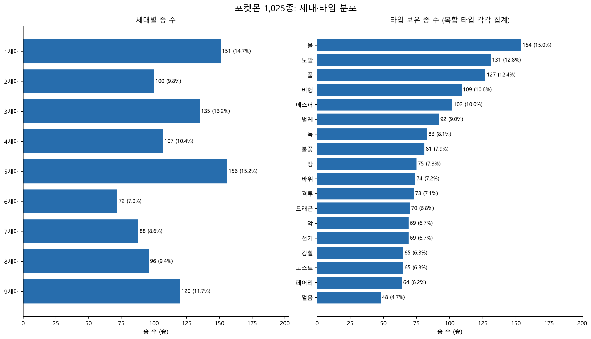
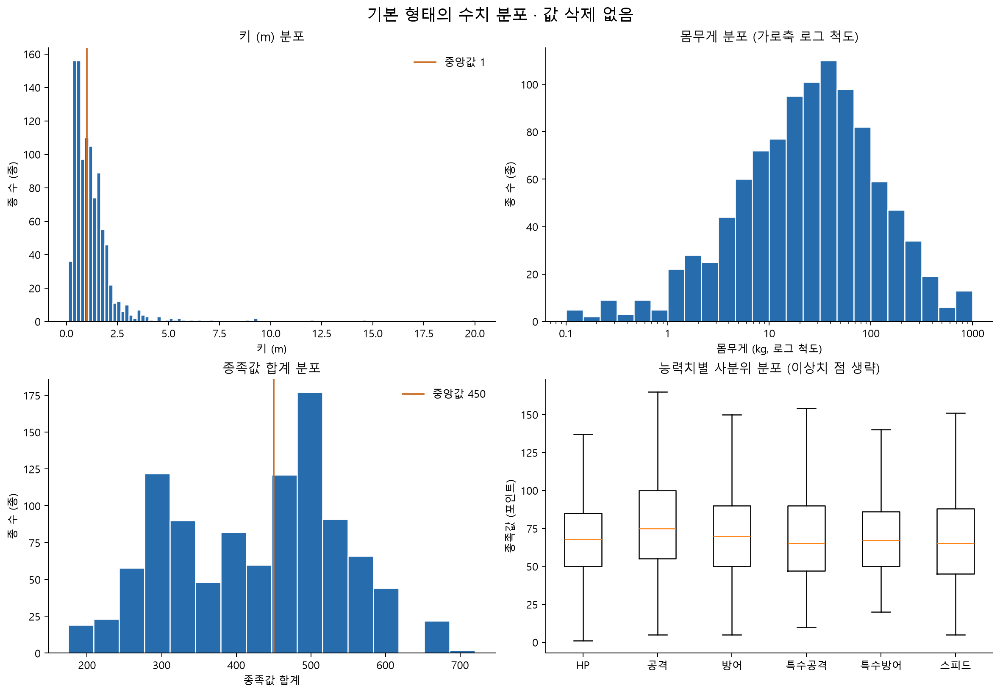
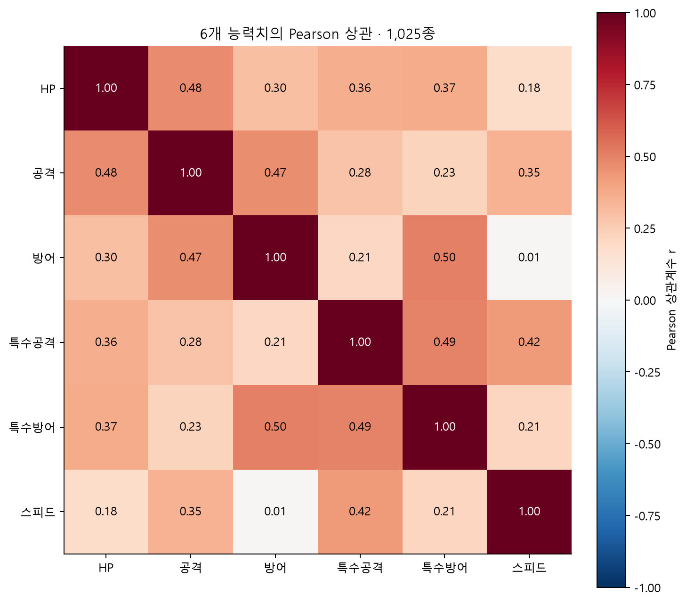
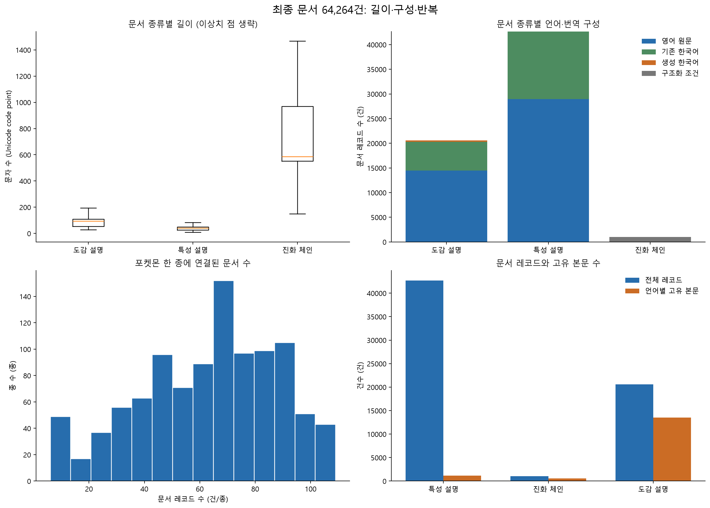

# 최종 포켓몬 데이터 통계 EDA

분석일: 2026-10-22. 기술통계만 수행했다. 외부 API·GMS·임베딩·모델 학습·검색 품질 실험은 실행하지 않았다.

## 분석 단위와 조건

- 종 단위: 전국도감 1~1,025번의 기본 개체. 리전폼·메가진화 등 형태별 개체 1,351개를 별도 종으로 세지 않는다.
- 수치·타입·특성은 고정 원본 스냅샷의 기본 형태 기준이다. 세대별 표의 세대는 최초 등장 세대이며, 각 세대 당시의 과거 능력치를 뜻하지 않는다.
- 문서 단위: 원본 64,017건 + 생성 한국어 247건 = 64,264건. 같은 설명이 항목·버전에 따라 반복 연결된다.
- 표준편차는 모집단 기준(ddof=0). 분위수는 선형 보간. IQR 밖 값은 Q1−1.5×IQR 미만 또는 Q3+1.5×IQR 초과이며 삭제하지 않았다.
- 포켓몬 설정 전체 목록에 대한 관측 요약이다. 무작위 표본이 아니므로 p값·신뢰구간·인과관계를 제시하지 않는다.

## 1. 기본 품질·구조

- 고유 종 ID 1,025 / 고유 문서 ID 64,264. 연결 없는 문서 0 / 빈 본문 0.
- 8개 핵심 수치의 결측 0 / 0 이하 키 0 / 0 이하 몸무게 0.
- 중첩 특성 한국어 이름 결측 0개 항목 연결. 특성 자체가 없다는 뜻과 구별한다.
- 원본 입력 파일 SHA-256 실행 전후 일치. 원본·최종 보완본 모두 수정하지 않았다.

| 필드 | 결측 항목 수 |
| --- | --- |
| item_id | 0 |
| name | 0 |
| name_ko | 0 |
| genus_ko | 0 |
| generation | 0 |
| types | 0 |
| abilities | 0 |
| index_text | 0 |

## 2. 세대·타입·분류 분포

| 세대 | 종수 | 전체대비비율(%) | 전설 | 환상 | 종족값평균 | 종족값중앙값 |
| --- | --- | --- | --- | --- | --- | --- |
| 1세대 | 151 | 14.73 | 4 | 1 | 407.64 | 405.00 |
| 2세대 | 100 | 9.76 | 5 | 1 | 407.18 | 415.00 |
| 3세대 | 135 | 13.17 | 8 | 2 | 403.73 | 410.00 |
| 4세대 | 107 | 10.44 | 9 | 5 | 445.57 | 480.00 |
| 5세대 | 156 | 15.22 | 9 | 4 | 425.76 | 445.50 |
| 6세대 | 72 | 7.02 | 3 | 3 | 429.31 | 450.00 |
| 7세대 | 88 | 8.59 | 11 | 5 | 449.41 | 480.00 |
| 8세대 | 96 | 9.37 | 11 | 1 | 439.22 | 481.50 |
| 9세대 | 120 | 11.71 | 11 | 1 | 457.39 | 488.50 |

단일 타입 499종(48.68%), 복합 타입 526종(51.32%). 타입 조합은 순서를 구분하지 않으면 154종류다.

타입 표는 복합 타입을 각각 집계하여 총 1,551회다. 비율의 분모는 고유 1,025종으로, 비율 합계는 100%를 넘는다.

| 타입 | 보유 종수 | 전체 종 대비(%) |
| --- | --- | --- |
| 물 | 154 | 15.02 |
| 노말 | 131 | 12.78 |
| 풀 | 127 | 12.39 |
| 비행 | 109 | 10.63 |
| 에스퍼 | 102 | 9.95 |
| 벌레 | 92 | 8.98 |
| 독 | 83 | 8.10 |
| 불꽃 | 81 | 7.90 |
| 땅 | 75 | 7.32 |
| 바위 | 74 | 7.22 |
| 격투 | 73 | 7.12 |
| 드래곤 | 70 | 6.83 |
| 악 | 69 | 6.73 |
| 전기 | 69 | 6.73 |
| 강철 | 65 | 6.34 |
| 고스트 | 65 | 6.34 |
| 페어리 | 64 | 6.24 |
| 얼음 | 48 | 4.68 |



## 3. 능력치·키·몸무게 기술통계

| 항목 | 건수 | 평균 | 표준편차 | 최솟값 | Q1 | 중앙값 | Q3 | 최댓값 | IQR 밖 건수 |
| --- | --- | --- | --- | --- | --- | --- | --- | --- | --- |
| HP | 1,025 | 70.18 | 26.62 | 1.00 | 50.00 | 68.00 | 85.00 | 255.00 | 18 |
| 공격 | 1,025 | 77.52 | 29.77 | 5.00 | 55.00 | 75.00 | 100.00 | 181.00 | 1 |
| 방어 | 1,025 | 72.51 | 29.27 | 5.00 | 50.00 | 70.00 | 90.00 | 230.00 | 11 |
| 특수공격 | 1,025 | 70.08 | 29.64 | 10.00 | 47.00 | 65.00 | 90.00 | 173.00 | 1 |
| 특수방어 | 1,025 | 70.21 | 26.63 | 20.00 | 50.00 | 67.00 | 86.00 | 230.00 | 11 |
| 스피드 | 1,025 | 67.19 | 28.70 | 5.00 | 45.00 | 65.00 | 88.00 | 200.00 | 2 |
| 종족값 합계 | 1,025 | 427.69 | 112.72 | 175.00 | 325.00 | 450.00 | 508.00 | 720.00 | 0 |
| 키 (m) | 1,025 | 1.21 | 1.25 | 0.10 | 0.50 | 1.00 | 1.50 | 20.00 | 40 |
| 몸무게 (kg) | 1,025 | 66.99 | 121.21 | 0.10 | 8.50 | 28.00 | 70.00 | 999.90 | 103 |

몸무게 평균 66.99kg, 중앙값 28.00kg으로 큰 값 쪽의 영향을 받는다. 키의 평균은 1.21m, 중앙값은 1.00m다.

종족값 합계는 HP·공격·방어·특수공격·특수방어·스피드의 단순 합이다. 대전 성능이나 사용률을 측정한 값이 아니다.

| 분류 | 종수 | 평균 | 중앙값 | 최솟값 | 최댓값 |
| --- | --- | --- | --- | --- | --- |
| 일반 | 931 | 411.10 | 425.00 | 175 | 670 |
| 전설 | 71 | 593.86 | 580.00 | 200 | 690 |
| 환상 | 23 | 586.09 | 600.00 | 300 | 720 |



몸무게 히스토그램은 양의 값의 로그 가로축이며 로그값의 평균을 표에 쓴 것은 아니다. 박스플롯에서만 이상치 점을 생략했고 모든 수치를 통계에 포함했다.

## 4. 상관관계

| 능력치 | HP | 공격 | 방어 | 특수공격 | 특수방어 | 스피드 |
| --- | --- | --- | --- | --- | --- | --- |
| HP | 1.00 | 0.48 | 0.30 | 0.36 | 0.37 | 0.18 |
| 공격 | 0.48 | 1.00 | 0.47 | 0.28 | 0.23 | 0.35 |
| 방어 | 0.30 | 0.47 | 1.00 | 0.21 | 0.50 | 0.01 |
| 특수공격 | 0.36 | 0.28 | 0.21 | 1.00 | 0.49 | 0.42 |
| 특수방어 | 0.37 | 0.23 | 0.50 | 0.49 | 1.00 | 0.21 |
| 스피드 | 0.18 | 0.35 | 0.01 | 0.42 | 0.21 | 1.00 |

절댓값이 큰 비대각 Pearson 상관 3쌍: 방어–특수방어 r=0.503, 특수공격–특수방어 r=0.493, HP–공격 r=0.476.

키–몸무게 상관은 Pearson r=0.632, Spearman ρ=0.836. 관측된 연관성이고 인과관계는 아니다.

종족값 합계와 각 구성 능력치의 상관은 합계 정의에 영향을 받으므로 위 6개 능력치 상관 표에 합계를 포함하지 않았다. Spearman 전체 표는 로컬 집계 파일에 저장했다.



## 5. 문서 구성·길이·반복

| 문서 종류 | en | ko | und |
| --- | --- | --- | --- |
| 특성 설명 | 28,983 | 13,695 | 0 |
| 진화 체인 | 0 | 0 | 1,025 |
| 도감 설명 | 14,496 | 6,065 | 0 |

| 문서 종류 | 건수 | 평균 | 표준편차 | 최솟값 | Q1 | 중앙값 | Q3 | 최댓값 | IQR 밖 건수 |
| --- | --- | --- | --- | --- | --- | --- | --- | --- | --- |
| 특성 설명 | 42,678 | 42.45 | 21.89 | 8.00 | 26.00 | 40.00 | 49.00 | 168.00 | 2,876 |
| 진화 체인 | 1,025 | 892.17 | 1,665.79 | 150.00 | 552.00 | 587.00 | 969.00 | 28,827.00 | 56 |
| 도감 설명 | 20,561 | 93.73 | 39.61 | 28.00 | 54.00 | 95.00 | 110.00 | 235.00 | 374 |

길이 단위는 Python 문자열의 문자 수(Unicode code point)다. 토큰 수가 아니며, 언어별 같은 문자 수가 같은 정보량·토큰 수라는 뜻도 아니다. 진화 체인은 구조화 JSON 문자열을 포함한다.

한 종에 연결된 문서 수의 기술통계:

| 항목 | 건수 | 평균 | 표준편차 | 최솟값 | Q1 | 중앙값 | Q3 | 최댓값 | IQR 밖 건수 |
| --- | --- | --- | --- | --- | --- | --- | --- | --- | --- |
| 문서 수 | 1,025 | 62.70 | 25.18 | 6 | 44.00 | 66.00 | 82.00 | 109 | 0 |

| 문서 종류 | 레코드 수 | 언어별 고유 본문 수 | 반복 레코드 수 | 반복 비율(%) | 동일 종 내부 반복 수 |
| --- | --- | --- | --- | --- | --- |
| 특성 설명 | 42,678 | 1,170 | 41,508 | 97.26 | 29,187 |
| 진화 체인 | 1,025 | 540 | 485 | 47.32 | 0 |
| 도감 설명 | 20,561 | 13,489 | 7,072 | 34.40 | 7,062 |

전체 언어별 고유 본문은 15,199개, 반복 레코드는 49,065건(76.35%)이다. 동일 언어·본문 해시 기준이며 게임 버전과 항목 ID는 구별하지 않은 수치다.

반복 비율이 높다는 사실만으로 잘못된 중복이라고 판단하지 않는다. 특성·진화 체인이 여러 항목에 연결되거나 동일 문구가 다른 버전에 수록된 경우를 포함한다. 본문이 같은 문서라도 출처·연결 항목·버전이 다를 수 있다. 이번 분석에서 삭제·병합하지 않았다.

문서의 직접 source_url은 3종이다. 이는 설명 CSV의 원문 URL 수이며, 64,264건의 독립된 외부 출처를 뜻하지 않는다. 보조 related_source_urls와 메타데이터 출처를 합친 전체 수집 파일 수와도 구별한다.



## 6. 원본 한국어·생성 번역 비중

| 세대 | 종수 | 원본 한국어 종수 | 생성 번역 보완 종수 | 최종 결측 종수 |
| --- | --- | --- | --- | --- |
| 1세대 | 151 | 151 | 0 | 0 |
| 2세대 | 100 | 100 | 0 | 0 |
| 3세대 | 135 | 135 | 0 | 0 |
| 4세대 | 107 | 107 | 0 | 0 |
| 5세대 | 156 | 156 | 0 | 0 |
| 6세대 | 72 | 72 | 0 | 0 |
| 7세대 | 88 | 88 | 0 | 0 |
| 8세대 | 96 | 89 | 7 | 0 |
| 9세대 | 120 | 0 | 120 | 0 |

생성 한국어 247건은 전체 문서의 0.38%, 한국어 문서의 1.25%다. 종 기준으로는 127/1,025=12.39%이며 문서 기준 비율과 다르다.

원본 한국어 설명 보유 898종과 생성 번역으로 보완한 127종을 합쳐 1,025종이다. 생성 번역 보완은 사실 정확성·공식 번역 일치·검색 품질을 통계적으로 검증한 결과가 아니다.

## 재현·산출물

```powershell
python -m pip install -r requirements-pokemon-eda.txt
python scripts/run_pokemon_eda.py
```

- 이 문서와 그림은 집계 결과만 포함한다. 포켓몬 개별 행·본문·키·원본 데이터는 Git에 추가하지 않는다.
- 상세 집계 CSV 12개와 검증 JSON은 로컬 `outputs/pokemon/eda/`에 저장한다. Git 제외 경로다.
- 실행 환경: pandas 3.0.6, NumPy 2.4.6, Matplotlib 3.11.2.
- 이번 작업은 기술통계 EDA로 종료한다. 이후 별도 작업에서 요구사항과 RAG 설계를 진행한다.
