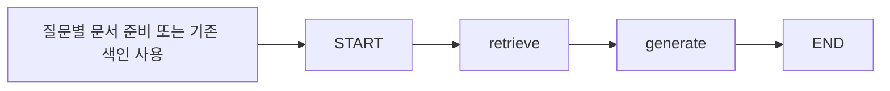

# 작업 5: 근거 검색·LangGraph 답변·인용 연결

실행일: 2026-10-23. CLI와 애플리케이션 모듈에서 두 컬렉션을 연결해 실제 GMS 답변을 검증했다. 화면·항목별 대화·조건 탐색·진화 카드 UI는 작업 6 범위다.

## 구현 구조



실제 LangGraph 작업 노드는 **retrieve, generate 두 개**다. 문서 준비는 그래프 밖에서 작업 4 모듈로 수행한다. `outputs/pokemon/rag/graph.json`에 실제 노드·간선 구조를 저장하고, 매 답변의 trace도 검사한다.

- 답변 모델: GMS Responses의 사용자 선택 `gpt-6.1-sol`.
- 질의 임베딩: GMS `text-embedding-3-small`, 1,536차원. Chroma 기본 임베딩으로 대체하지 않는다.
- 고정 실행 의존성: LangGraph 1.2.10, LangChain 1.3.14, langchain-core 1.6.0, LangSmith 0.10.17. 기존 실습 환경의 LangSmith를 프로젝트 명세 버전에 맞췄고 `pip check`를 통과했다.
- 키는 환경변수 또는 로컬 `streamlit_lab/.env`에서만 읽고 그래프 상태에 넣지 않는다. 실행은 `tracing_context(enabled=False)`로 감싸 문서 본문/프롬프트를 원격 추적 서비스에 자동 전송하지 않는다.

## 검색·병합·버전·언어

선택 포켓몬의 메타데이터는 ID로 직접 읽어 항상 근거 1번으로 유지한다. 설명 청크는 질문 임베딩으로 의미 검색한다. 메타와 문서의 원시 거리 점수를 서로 비교하지 않는다. 원본/설정/모델 서명을 대조하고, 기존 컬렉션이 없으면 검색 과정에서 빈 컬렉션을 만들지 않고 실패한다.

문서에는 선택 item_id와 원래 source_item_id를 모두 강제 필터한다. 관계 문서가 과거 질문에서 연결돼 있어도 다른 종의 설명을 선택 종의 설명으로 가져오지 않는다. 선택 종의 진화 체인 자체에 포함된 다른 종·분기는 체인 근거로 사용한다. 준비를 생략하는 경로도 다른 정확한 이름을 감지해 선택 변경을 안내하며, 진화 질문은 같은 체인에 연결된 종만 허용한다. 폭넓은 별칭·오타 판별은 아직 지원하지 않는다.

게임 요청은 알려진 식별자로 검증한다. 도감의 `version`은 정확히 일치시킨다. 특성의 `version_group`은 고정 CSV의 게임→그룹 관계로 필터한다. 요청 버전 설명이 없으면 다른 버전을 대신 넣지 않는다. 진화 체인의 혼합 범위는 특정 게임의 완전한 진화 가능성을 확정하는 근거로 쓰지 않는다.

같은 문서 종류·제목·버전·청크 위치의 표현을 대조해 원본 한국어 → 생성 한국어 → 영어 순으로 선택한다. 생성 번역은 original_doc_id로 영어 원문을 연결하며, 실제 원문 텍스트도 모델에 제공한다. 다른 문서를 임의로 번역 쌍으로 연결하지 않는다.

이후 동일 종·종류·언어·본문 해시의 **정확한 중복만** 병합하고 청크/doc_id/버전 목록을 보존한다. 일반 질문은 동일 본문의 여러 버전을 묶을 수 있으나 버전 비교 질문에서는 버전 경계를 유지한다. 비슷한 문장을 같은 사실로 간주하는 의미 중복 제거 또는 MMR은 구현하지 않았다.

## 근거 수와 토큰 예산

[설정 파일](../../../config/pokemon_rag.toml)의 기본값은 fetch 30, 최대 후보 200, 문서 Top-k 5, 근거 토큰 예산 6,000이다. 메타 1건은 Top-k와 별도로 포함한다. 필터/중복 제거 후 부족하면 후보를 추가로 검색한다. 예산 초과 시 문서를 줄이되 메타를 조용히 삭제하거나 본문을 무표시로 자르지 않는다. 번호는 최종 근거 목록에서 부여한다.

이브이의 동일 질문을 실제 검색한 결과:

| 문서 Top-k 설정 | 포함된 설명 근거 | 메타 포함 근거 수 | 근거 토큰 |
|---|---:|---:|---:|
| 3 | 3 | 4 | 2,402 |
| 5 | 5 | 6 | 3,686 |
| 8 | 8 | 9 | 5,602 |

토큰은 `cl100k_base`로 직렬화한 모델용 근거를 센 값이다. 질문·지시문·출력 토큰과는 구별한다. 보조 원문 URL 목록은 표시 레지스트리에 보존하고 모델 입력에서 제외한다. 이 비교는 검색 설정의 동작 검사이며 답변 품질 향상이나 최적값을 입증하지 않는다.

## 답변과 인용 계약

프롬프트 3은 근거만 사용하고 주요 사실마다 `[근거 N]`을 붙이며 모르는 내용은 확인 불가로 답하도록 한다. 스냅샷 수치를 과거 게임 수치로 표현하지 않고, 진화 형태·조건 AND/OR·원문 아이템 식별자·번역의 비공식 여부를 보존하도록 지시한다. 문서 내부의 역할 변경/비밀 출력 지시는 데이터로 취급한다.

내부 응답은 `answer` 문자열과 `status=answered/insufficient`의 JSON으로 검증한다. 사용자에게는 answer 문자열을 제공한다. 설계의 사용자용 문자열 출력을 유지하면서 내부 파싱 계약을 추가했다.

- 번호 범위 밖·깨진 형식·닫히지 않은 인용, 사실 답변의 무인용, 모델이 임의 생성한 HTTP URL은 거절한다. 계약 위반은 GMS JSON 모듈에서 검증 오류와 직전 출력을 데이터로 제공해 1회 수정 요청 후 실패한다. 거절된 응답은 로컬 캐시의 rejected 하위에만 기록한다.
- `sources`에는 실제 유효하게 인용된 근거만 남기고 본문은 제외한다. 제목·유형·원문 URL·보조 출처·종·언어·버전·번역 여부·원본 문서 ID를 레지스트리에서 가져온다.
- 메타의 보조 출처에는 타입·능력치·한국어명·특성 등에 실제 사용된 고정 원본 파일 URL도 포함한다. 모델이 만들어낸 URL을 출처로 채택하지 않는다.
- 생성 번역이 인용되면 번역 안내를, 진화가 인용되면 게임별 적용/완전성 미확인 안내를 코드에서도 덧붙인다.
- 인용이 없으면 `citation_notice`로 그 사실을 반환한다. CLI에 표시했고 실제 UI 표시는 작업 6에서 확인한다.

인용 번호의 유효성은 주장이 원문으로 뒷받침된다는 사실을 자동 증명하지 않는다. 주요 주장 전체의 인용 누락·문장별 지지 여부는 별도 평가가 필요하다.

## 대표 사례 실행 결과

| 사례 | 확인한 처리 |
|---|---|
| 피카츄 → 라이츄 조건 | 수집 조건 행을 인용하고 기본 형태/별도 결과 형태 및 게임 적용 범위를 구분 |
| 이브이 진화 분기 | 검색된 일부 분기만 비교하며 전체 분기 목록이라고 단정하지 않음 |
| 미라이돈 바이올렛 도감 | violet 근거만 사용, 생성 한국어 번역 안내와 영어 원문 연결 |
| 피카츄 X·Y 도감 비교 | 두 버전의 출처를 각각 인용, 버전 경계를 보존 |
| 피카츄 기술 습득 레벨 | 미수집 범위로 확인 불가, 답변 생성 호출 없이 무인용 안내 |
| 피카츄 선택 후 리자몽 질문 | 선택 변경 안내, 다른 항목 근거 혼입 없음 |
| 미라이돈 레드 도감 | 해당 버전 설명이 없어 확인 불가, 다른 버전 설명으로 대체하지 않음 |
| 피카츄 현재 기본 형태 수치 | 메타 근거 1번을 인용해 답함 |

실제 8사례에서 두 노드 trace, 선택 메타 포함, 종 격리, 인용 번호/반환 출처 일치, 토큰 예산, 지원 불가 상태를 검사했다. 생성 번역·두 버전 출처·메타 인용 등 사례별 조건도 확인했다. 모두 오프라인 재실행에서 답변/출처가 동일하고 추가 답변·질의 임베딩 호출이 0회였다. 원본 세 데이터 파일의 SHA-256도 유지됐다.

에이전트가 실제 답변과 검색 근거를 읽어 범위·아이템 식별자·번역 표시·버전 분리를 점검했다. 독립된 사람의 정답 평가, 전체 1,025종의 품질 검증, 상호 검증, RAG 사용 전후 비교(F2015)는 수행하지 않았다. 캐시 적중과 실제 모델 호출이 섞인 개발 실행 시간이므로 서비스 p95나 비용 목표 달성을 주장하지 않는다.

## 재현과 저장

```powershell
python -m pip install -r requirements-pokemon-rag.txt
python scripts/ask_pokemon.py --item 25 --question "피카츄가 라이츄로 진화하는 조건을 찾아줘"
python scripts/ask_pokemon.py --item 25 --question "피카츄가 라이츄로 진화하는 조건을 찾아줘" --offline
python scripts/ask_pokemon.py --item 25 --question "피카츄의 X와 Y 버전 도감 설명을 비교해 줘" --version x --version y --skip-prepare
python scripts/verify_pokemon_rag.py
python -m unittest discover -s tests -p "test_pokemon*.py" -v
```

기본 실행은 질문별 문서 준비 후 답변한다. `--skip-prepare`는 이미 색인된 문서만 사용한다. `--offline`은 준비/임베딩/답변의 캐시 누락 시 실패하고 네트워크로 대체하지 않는다. 지원하지 않는 범위를 모두 패턴으로 판별하는 것은 아니며, 현재 알려진 미수집 질문 패턴과 프롬프트 1의 unsupported를 함께 사용한다.

모델 응답 캐시는 로컬 `dataset/pokemon/rag/cache/`, 전체 답변/근거/진단은 `outputs/pokemon/rag/answers/`, 집계 검증은 `outputs/pokemon/rag/verification.json`에 둔다. 모두 Git 제외다. 포켓몬 관련 테스트 **47개**와 `pip check`가 통과했다. 신규 10개는 인용·출처 제한, 오류 피드백 재시도, 중복/버전, 언어 우선순위, 메타 예산, 두 노드, 미지원 무호출, 다른 종 요청의 격리를 검증한다.

다음은 작업 6: 항목별 대화 화면·진행/오류 안내·자연어 조건 탐색·근거 기반 진화 카드다.

참고: [LangGraph StateGraph](https://docs.langchain.com/oss/python/langgraph/graph-api), [Chroma 메타데이터 필터](https://docs.trychroma.com/docs/querying-collections/metadata-filtering).
